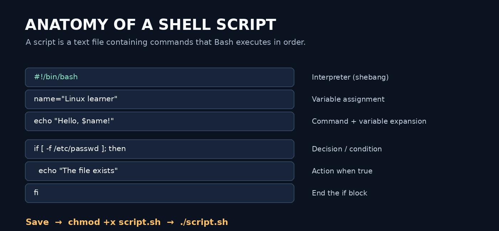
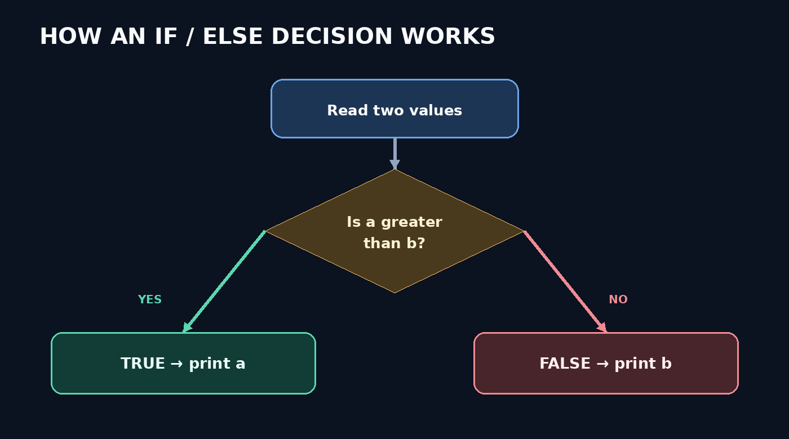
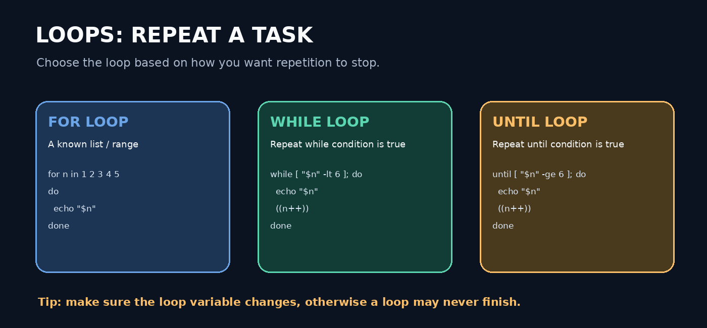

# 🐚 Shell Scripting for Beginners

<p align="center">
  
</p>

<p align="center">
  <b>A beginner-friendly, hands-on guide to Linux Shell / Bash Scripting</b><br>
  Learn the basics, understand each command, practise conditions and loops, and prepare for common scripting interview questions.
</p>

---

## 📚 What you will learn

| Section | Topics |
|---|---|
| 1. Introduction | What scripting is, Bash, shebang, creating and running scripts |
| 2. Variables & input | Assigning values, reading input with `read` |
| 3. Operators | Arithmetic, relational, logical and assignment operators |
| 4. Decision making | `if`, `if-else`, `if-elif-else` |
| 5. Loops | `for`, `while`, `until`, and infinite loops |
| 6. Practical scripts | Arithmetic, comparisons, directories and user management |
| 7. Interview practice | Common questions and coding exercises |

> **Who is this for?** Anyone starting Linux, Bash, system administration, or DevOps. You can practise on a Linux VM, an Ubuntu server, or WSL.

## 🧭 Suggested learning path

1. Read the explanation for a topic.
2. Type the example yourself instead of only copying it.
3. Save it in a `.sh` file.
4. Run it and compare your output.
5. Change the values and test again.
6. Try the practice questions without looking at the solution.

---

# 1. Introduction to Shell Scripting

## What is a shell?

A shell is a command interpreter. It accepts commands and asks the operating system to perform tasks. Bash (Bourne Again Shell) is a widely used shell on Linux.

## What is shell scripting?

A **script** is a text file containing a sequence of commands. When the script is run, the commands are executed in order. A script helps automate repeated tasks such as creating folders, checking files, processing data, and managing users.

## What is a shebang?

The **shebang** is the first line of a script. It starts with `#!` and identifies the interpreter that should run the script.

```bash
#!/bin/bash
```

This tells the system to run the file using Bash.

<p align="center">
  
</p>

## Create and run your first script

### Step 1 — Create a file

```bash
nano hello.sh
```

### Step 2 — Add the script

```bash
#!/bin/bash
echo "Hello, Linux!"
echo "I am learning shell scripting."
```

### Step 3 — Save and give execute permission

```bash
chmod 744 hello.sh
```

`chmod` changes file permissions. `744` gives the owner read, write and execute permissions, and gives the group and others read permission.

### Step 4 — Run it

```bash
./hello.sh
```

You can also run a script by explicitly calling Bash:

```bash
bash hello.sh
```

**What each command means**

| Command | Purpose |
|---|---|
| `nano hello.sh` | Opens/creates a text file in Nano |
| `chmod 744 hello.sh` | Sets permissions so the owner can execute it |
| `./hello.sh` | Runs the executable script in the current directory |
| `bash hello.sh` | Runs the file using Bash without needing its execute bit |

> **Note:** `.sh` is a common file extension, but it is not mandatory. The shebang is useful when you execute a script directly as `./filename`.

---

# 2. Variables and User Input

A variable stores a value that can be reused in a script.

## Assign a value

```bash
#!/bin/bash
name="Snehal"
city="Mumbai"

echo "Name: $name"
echo "City: $city"
```

**Remember:** Do not put spaces around `=` when assigning a Bash variable.

```bash
name="Linux"     # Correct
# name = "Linux" # Incorrect
```

`$name` means “use the value stored in the variable named `name`”.

## Take input from the user

```bash
#!/bin/bash
read -p "Enter your name: " name
echo "Welcome, $name!"
```

- `read` waits for the user to type something.
- `-p` displays a prompt.
- `name` stores the entered value.

---

# 3. Operators in Shell Scripting

Operators let you perform calculations and comparisons.

## 3.1 Arithmetic operators

| Operator | Meaning | Example result |
|---|---|---|
| `+` | Addition | `20 + 10 = 30` |
| `-` | Subtraction | `20 - 10 = 10` |
| `*` | Multiplication | `20 * 10 = 200` |
| `/` | Integer division | `20 / 10 = 2` |
| `%` | Remainder (modulo) | `21 % 10 = 1` |

### Example — all four basic calculations

```bash
#!/bin/bash
a=20
b=10

echo "Addition: $((a + b))"
echo "Subtraction: $((a - b))"
echo "Multiplication: $((a * b))"
echo "Division: $((a / b))"
```

`$(( ... ))` is Bash arithmetic expansion. It is usually easier to read than the older `expr` command.

### Example — take numbers as input

```bash
#!/bin/bash
read -p "Enter the first number: " a
read -p "Enter the second number: " b

echo "Addition: $((a + b))"
echo "Subtraction: $((a - b))"
echo "Multiplication: $((a * b))"

if [ "$b" -ne 0 ]; then
    echo "Division: $((a / b))"
else
    echo "Cannot divide by zero."
fi
```

> Bash arithmetic uses integers by default. For decimal calculations, use a tool such as `bc` (if installed). Always check that the divisor is not zero.

## 3.2 Relational operators

These operators compare integers inside `[ ... ]`.

| Operator | Meaning |
|---|---|
| `-gt` | Greater than |
| `-lt` | Less than |
| `-eq` | Equal to |
| `-ne` | Not equal to |
| `-ge` | Greater than or equal to |
| `-le` | Less than or equal to |

Example:

```bash
a=20
b=10

if [ "$a" -gt "$b" ]; then
    echo "$a is greater than $b"
fi
```

## 3.3 Logical operators

Logical operators combine or reverse conditions.

| Operator | Meaning | Example |
|---|---|---|
| `-a` | AND (both conditions true) | `[ "$a" -gt 5 -a "$b" -lt 20 ]` |
| `-o` | OR (at least one condition true) | `[ "$a" -gt 5 -o "$b" -lt 20 ]` |
| `!` | NOT (reverses a condition) | `[ ! -f file.txt ]` |

For modern Bash scripts, `[[ ... && ... ]]` and `[[ ... || ... ]]` are often clearer:

```bash
if [[ "$a" -gt 5 && "$b" -lt 20 ]]; then
    echo "Both conditions are true."
fi
```

## 3.4 Assignment operator

The `=` symbol assigns a value:

```bash
count=5
```

For numeric comparisons, use `-eq` inside `[ ... ]` or `==` inside `[[ ... ]]`. Assignment and comparison are different operations.

---

# 4. Decision-Making Statements

Decision statements allow a script to choose which commands to run based on a condition.

## 4.1 `if` statement

**Syntax**

```bash
if [ condition ]; then
    # Commands run when condition is true
fi
```

**Example — check whether the first number is greater**

```bash
#!/bin/bash
read -p "Enter first number: " a
read -p "Enter second number: " b

if [ "$a" -gt "$b" ]; then
    echo "Greater number is $a"
fi
```

## 4.2 `if-else` statement

Use `else` when you want one action for a true condition and another action when it is false.

```bash
#!/bin/bash
read -p "Enter first number: " a
read -p "Enter second number: " b

if [ "$a" -eq "$b" ]; then
    echo "Both numbers are equal."
else
    echo "Both numbers are different."
fi
```

## Find the greater number

```bash
#!/bin/bash
read -p "Enter first number: " a
read -p "Enter second number: " b

if [ "$a" -gt "$b" ]; then
    echo "Greater number is $a"
elif [ "$b" -gt "$a" ]; then
    echo "Greater number is $b"
else
    echo "Both numbers are equal."
fi
```

## Find the smaller number

```bash
#!/bin/bash
read -p "Enter first number: " a
read -p "Enter second number: " b

if [ "$a" -lt "$b" ]; then
    echo "Smaller number is $a"
elif [ "$b" -lt "$a" ]; then
    echo "Smaller number is $b"
else
    echo "Both numbers are equal."
fi
```

## Check pass or fail

```bash
#!/bin/bash
read -p "Enter your marks: " marks

if [ "$marks" -gt 35 ]; then
    echo "Result is Pass"
else
    echo "Result is Fail"
fi
```

This follows the threshold in the class example: marks greater than 35 pass. If your requirement is “35 and above”, change `-gt` to `-ge`.

## 4.3 `if-elif-else` statement

Use this when there are multiple conditions to test.

```bash
#!/bin/bash
read -p "Enter first number: " a
read -p "Enter second number: " b

if [ "$a" -gt "$b" ]; then
    echo "$a is greater."
elif [ "$a" -lt "$b" ]; then
    echo "$b is greater."
else
    echo "Both numbers are equal."
fi
```

<p align="center">
  
</p>

### Quick summary

| Statement | When to use it |
|---|---|
| `if` | Run commands only when a condition is true |
| `if-else` | Choose between two paths |
| `if-elif-else` | Choose among multiple conditions |

---

# 5. Loops in Shell Scripting

A **loop** repeats a block of commands. Use loops to perform the same task for multiple users, directories, files, or numbers.

<p align="center">
  
</p>

## 5.1 `for` loop

Use a `for` loop when you have a list of values or a known range.

### Print a list of values

```bash
#!/bin/bash
for n in 1 2 3 4 5
do
    echo "Number is $n"
done
```

### C-style `for` loop

```bash
#!/bin/bash
for ((n=1; n<=5; n++))
do
    echo "Number is $n"
done
```

- `n=1` — starting value.
- `n<=5` — continue while this condition is true.
- `n++` — increase `n` by one after each iteration.

### Print a message five times

```bash
#!/bin/bash
for ((n=1; n<=5; n++))
do
    echo "Hello all"
done
```

### Create multiple directories

```bash
#!/bin/bash
for n in 1 2 3 4 5
do
    mkdir -p "dir$n"
done
```

This creates `dir1`, `dir2`, `dir3`, `dir4`, and `dir5` in the current directory. `-p` avoids an error if a directory already exists.

## 5.2 `while` loop

A `while` loop repeats **while its condition is true**.

```bash
#!/bin/bash
n=1

while [ "$n" -lt 6 ]
do
    echo "$n"
    n=$((n + 1))
done
```

Output:

```text
1
2
3
4
5
```

The variable is increased each time. If you forget to update it, the condition may remain true forever.

## 5.3 `until` loop

An `until` loop repeats **while its condition is false**. It stops when the condition becomes true.

```bash
#!/bin/bash
n=1

until [ "$n" -ge 6 ]
do
    echo "$n"
    n=$((n + 1))
done
```

## Difference between `while` and `until`

| `while` | `until` |
|---|---|
| Repeats while condition is true | Repeats while condition is false |
| Stops when condition becomes false | Stops when condition becomes true |

## 5.4 Infinite loop

An infinite loop keeps running until it is stopped or its script exits. Use it carefully.

```bash
#!/bin/bash
while true
do
    echo "Running... press Ctrl+C to stop"
    sleep 2
done
```

Press `Ctrl+C` to interrupt it.

---

# 6. Practical Shell Scripting Examples

> **Important:** User-management scripts change the operating system. Run them only on a test Linux machine or with permission. They normally require `sudo` or root privileges. Review the usernames before executing.

## 6.1 Create multiple users

```bash
#!/bin/bash
for username in user1 user2 user3
do
    sudo useradd "$username"
    echo "Created user: $username"
done
```

`useradd` creates a user account. This simple example does not set a password.

## 6.2 Delete multiple users

```bash
#!/bin/bash
for username in user1 user2 user3
do
    sudo userdel "$username"
    echo "Requested deletion of: $username"
done
```

`userdel` deletes an account. Add `-r` only when you intentionally want to remove that user's home directory and mail spool too. Deletion can be destructive, so check the account list first.

## 6.3 Create users and set passwords

The original class note uses `passwd --stdin`, which is supported by some distributions but not all (for example, it is not portable to Ubuntu/Debian). A more widely available interactive approach is:

```bash
#!/bin/bash
for username in user1 user2 user3
do
    sudo useradd "$username"
    sudo passwd "$username"
done
```

The script prompts you to enter and confirm each user's password. Avoid hard-coding shared passwords in scripts.

## 6.4 Create multiple directories

```bash
#!/bin/bash
for directory in /tmp/dir1 /tmp/dir2 /tmp/dir3
do
    sudo mkdir -p "$directory"
    echo "Created: $directory"
done
```

## 6.5 Print odd numbers from 1 to 20

```bash
#!/bin/bash
for ((n=1; n<=20; n+=2))
do
    echo "$n"
done
```

## 6.6 Print even numbers from 1 to 20

```bash
#!/bin/bash
for ((n=2; n<=20; n+=2))
do
    echo "$n"
done
```

---

# 7. Common Commands Cheat Sheet

| Command | What it does |
|---|---|
| `pwd` | Shows the current directory |
| `ls` | Lists files and directories |
| `cd path` | Changes directory |
| `touch file.sh` | Creates an empty file (or updates its timestamp) |
| `nano file.sh` | Opens a file in the Nano editor |
| `cat file.sh` | Displays file contents |
| `chmod +x file.sh` | Adds execute permission according to the permission rules |
| `./file.sh` | Runs an executable file in the current directory |
| `bash file.sh` | Runs a script using Bash |
| `echo "text"` | Prints text |
| `read variable` | Reads user input |
| `mkdir directory` | Creates a directory |
| `useradd username` | Creates a user account |
| `userdel username` | Deletes a user account |
| `id username` | Displays user and group IDs |
| `Ctrl+C` | Interrupts the foreground command |

---

# 8. Common Beginner Mistakes

1. **Spaces around `=`:** `name="Sam"` is correct; `name = "Sam"` is not a valid assignment.
2. **Missing spaces in tests:** write `[ "$a" -gt "$b" ]`, with spaces after `[` and before `]`.
3. **Unquoted variables:** prefer `"$name"` to avoid word-splitting and wildcard expansion.
4. **Wrong arithmetic syntax:** use `$((a + b))` for Bash arithmetic.
5. **Division by zero:** check the divisor before dividing.
6. **Loop never ends:** update the loop variable or make sure the condition eventually becomes false (for `while`) or true (for `until`).
7. **Permission denied:** check execute permission or run with `bash filename.sh`.
8. **Running destructive commands too early:** test user deletion and file operations in a disposable VM first.

## Debug a script

Run Bash with tracing enabled to see commands as they execute:

```bash
bash -x script.sh
```

Check syntax without running the script:

```bash
bash -n script.sh
```

---

# 9. Interview Questions

Use these questions to check your understanding. Try answering in your own words.

1. What is scripting?
2. What is shell scripting?
3. What is a shebang?
4. Why is the shebang important?
5. What does `#!/bin/bash` mean?
6. Is the `.sh` extension mandatory?
7. How do you give execute permission to a script?
8. What is a variable? How do you assign a value in Bash?
9. What is the purpose of the `read` command?
10. What are arithmetic operators?
11. What is the difference between `-gt` and `-ge`?
12. What do AND, OR, and NOT mean?
13. What is the difference between `if` and `if-else`?
14. When would you use `if-elif-else`?
15. What is a loop?
16. Name the loop types covered in this guide.
17. What is the difference between `while` and `until`?
18. What can cause an infinite loop?
19. How do you debug a Bash script?
20. What is the difference between `bash script.sh` and `./script.sh`?

## Practical interview exercises

- Write a script to create three users.
- Write a script to delete a list of test users.
- Write a script to create users and prompt for their passwords.
- Write scripts to add, subtract, multiply, and divide two numbers.
- Find the greater and smaller of two numbers.
- Check whether two numbers are equal.
- Print numbers from 1 to 100.
- Print odd numbers and even numbers.
- Create five directories using a loop.
- Print a message five times using a `for` loop.

---

# 10. Mini Practice Challenge

Try these without looking at the examples above:

- [ ] Ask for a user's name and print a welcome message.
- [ ] Ask for two numbers and display their sum.
- [ ] Check whether a number is positive, negative, or zero.
- [ ] Print numbers from 10 down to 1.
- [ ] Print only even numbers between 1 and 50.
- [ ] Create directories named `project1` through `project5`.
- [ ] Ask for marks and print Pass or Fail.
- [ ] Create a script that checks whether `/etc/passwd` exists.

---

## 📁 Repository structure

```text
shell-scripting-learning/
│
├── README.md
└── images/
    ├── shell-script-anatomy.png
    ├── if-else-flowchart.png
    └── loop-types.png
```

## 🚀 Upload this project to GitHub

From inside the extracted project folder:

```bash
git init
git add README.md images/
git commit -m "Add beginner shell scripting learning guide"
git branch -M main
git remote add origin https://github.com/YOUR-USERNAME/YOUR-REPOSITORY.git
git push -u origin main
```

Replace the GitHub URL with your own repository URL. If the repository already contains a README or commits, pull/reconcile those changes before pushing.

## 🎯 Final learning advice

Shell scripting becomes easy when you practise small scripts every day. Start with `echo`, variables, and `read`; then move to operators, conditions, and loops. After that, automate safe tasks on a test Linux machine.

**Keep practising. One small script at a time!**

---

<p align="center">
  Made for Linux and DevOps beginners 🐧
</p>
